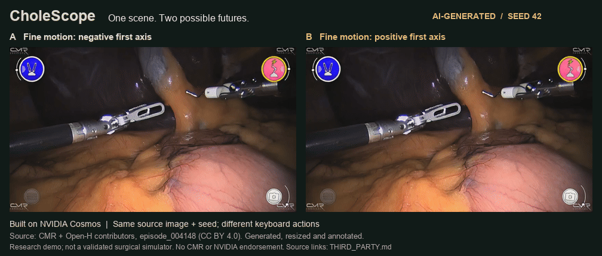

# CholeScope

Explore two surgical action sequences from one starting image. CholeScope adds
mouse dragging, desktop keyboard controls, recorded A/B comparisons, and
action exports to
[NVIDIA Cosmos3-H-Dreams](https://huggingface.co/nvidia/Cosmos3-H-Dreams).
The intended scene is robotic cholecystectomy: a left grasper and right hook in
an endoscopic view.

**Built on NVIDIA Cosmos.**

The application uses pretrained Cosmos weights. An optional coordinate lesson
trains a small controller to produce geometric reaching commands while Cosmos
stays frozen. Generated footage is a research demonstration, not a clinically
validated simulator.

https://github.com/user-attachments/assets/d4c4cf89-9224-44ae-8c5b-87600c66102c

**Live demo — 60 seconds, 2× speed**
· [Download MP4](assets/cholescope-live-demo.mp4)
· [Animated preview](assets/cholescope-live-preview.gif)
· [Poster](assets/cholescope-live-demo.jpg)

A continuous two-minute browser session, shown at **2× speed**: drag the
grasper, record A, reset to the same image and seed, record an opposing input
as B, compare synchronized recordings, and export the actual model actions.
The video includes real inference and waiting time; the framing, visible
cursor, and chapter captions were added for presentation. Silent H.264 MP4,
1920 × 1080. Setup and model warmup precede the take.

*Built on NVIDIA Cosmos. Scene: CMR / Open-H-Embodiment, CC BY 4.0.
See [demo attribution and reproduction](THIRD_PARTY.md#live-interface-demo).*

<details>
<summary>Earlier generated A/B example</summary>



*AI-generated A/B continuations: the same CMR starting image and seed `42`,
with opposing fine motions of the left grasper along the first model axis.
Source: CMR / Open-H-Embodiment, CC BY 4.0; resized and annotated.
See [media attribution](THIRD_PARTY.md#published-demo-animations).*

</details>

A paired responsiveness run on **24 October 2026** used an **RTX PRO 6000
Blackwell (96 GB)**, the frozen two-step BF16 checkpoint, full Wan VAE decoder,
and 832 × 480 output. Five images came from separate CMR source recordings:
three showed the intended two tools, and two included extra instruments as
stress cases. Each configuration generated 25 short rollouts with identical
64-step action sequences and seed `42`; all **50 rollouts / 3,200 frames**
completed. These images are not proven held out from Cosmos pretraining.

| Frames per chunk | Median chunk-ready latency | 95th percentile | Generation-only throughput |
| --- | --- | --- | --- |
| 8 | 1.177 s | 1.200 s | 16.75 FPS |
| 4 | 0.571 s | 0.585 s | 14.81 FPS |

Four-frame chunks reduced median first-action-sample-to-decoded-chunk latency
by **51.5%**. Both configurations use the corrected sampling cadence, which
also removes an unnecessary 100 ms wait from every chunk. Measurements include
all chunks in these short rollouts, including history-cache filling; they
exclude network transfer and playback. Generation-only throughput excludes
input sampling, so it is not the interface's delivered frame rate.

The faster setting changes generated output. Tool shape and texture can drift,
and small Y commands often produced little measurable motion in these tests.
These measurements do not establish reliable visual control, physical fidelity,
or generalization to unseen anatomy. The standalone default keeps NVIDIA's
eight-frame preset; use `--chunk-frames 4` on the server or
`scripts/launch_gpu.py` for the experimental lower-latency setting, or
`"chunk_frames": 4` in the private pod configuration before starting a new app
session. Set it to `8` to return to the baseline. Review the generated scene
when changing this setting.

The full Wan VAE decoder is the default because it preserves sharper detail
than the tiny TAEHV approximation. `--decoder taehv` restores that faster,
softer decoder on the direct server. The earlier A/B example above was made
with the earlier TAEHV configuration; its measured throughput was 34.7 FPS
with about 1.05 seconds chunk-ready latency. A separate single-scene TAEHV
check on the same GPU model (two seeds of 192 frames, steady-state chunks)
measured 40 FPS generation-only throughput with eight-frame chunks and 32 FPS
with four. Its median chunk-ready latencies under the old sampling cadence
were 1.00 s and 0.53 s; without the 100 ms wait they would be about 0.90 s and
0.43 s, an adjustment rather than a new measurement. Those historical
measurements are not directly comparable to the five-scene run. Larger
canvases did not improve
the previous example-scene check: the checkpoint was trained at 832 × 480,
960 × 544 looked no sharper, and 1280 × 720 turned hazy.

## Try the interface

Use Python 3.12 or newer and [uv](https://docs.astral.sh/uv/).

```bash
uv sync --extra test
uv run cholescope --preview
```

Open [localhost:8790](http://127.0.0.1:8790). Preview mode shows the interface and
disables inference and recording. It does not generate substitute footage.
To display an existing surgical image, add `--scene-dir /path/to/scenes`, or
`--upstream-root /path/to/cosmos3-h-dreams` to use NVIDIA's attributed example.

### Start and stop an existing RunPod pod

The optional local launcher keeps the interface available while the GPU is
stopped. **Start pod** resumes the configured pod, connects its SSH tunnel,
loads the cached model, and enables the demo. **Stop pod** closes the operator
connection, asks the model server to finish its recording, and stops the pod.
The default controls resume and stop one existing pod. The optional replacement
mode below can create one new pod when that pod's host has no GPU capacity;
neither mode deletes pods or volumes. The mounted volume must already have the
GPU environment and assets described below; resuming does not redownload weights.
Place those assets on a persistent or network volume. RunPod's temporary
container disk is cleared on restart, even when its directory is named
`/workspace`. A stopped pod also needs available GPU capacity on its host to
resume; the interface reports capacity failures. Replacement mode also depends
on available capacity in the volume's data center.

Keep the API key, SSH key, configuration, and budget state outside the checkout.
The key files must have permissions `0600`. For example, save this configuration
as `/path/to/private/runpod.json`, replacing the identity, paths, and spending
baseline with your own values:

```json
{
  "pod_id": "your-existing-pod-id",
  "pod_name": "your-exact-pod-name",
  "created_at": "2026-01-01T00:00:00Z",
  "key_file": "/path/to/private/runpod-api-key",
  "ssh_key": "/path/to/private/ssh-key",
  "known_hosts": "/path/to/private/known_hosts",
  "state_dir": "/path/to/private/demo-state",
  "initial_spend_usd": 0,
  "initial_spend_epoch": 1767225600,
  "remote_repo": "/workspace/cholescope",
  "remote_assets": "/workspace/cholescope-assets",
  "remote_private": "/workspace/cholescope-private",
  "session_minutes": 60,
  "max_rate": 3,
  "storage_reserve": 5,
  "paused_storage_rate": 0.05,
  "remote_guard": false,
  "allow_replacement": false
}
```

For an optional available-host fallback, add the following fields to the same
private configuration. Use the existing 150 GB standard network volume's ID
and data center, plus the Ed25519 public key corresponding to `ssh_key`:

```json
{
  "allow_replacement": true,
  "replacement": {
    "gpu_id": "NVIDIA RTX PRO 6000 Blackwell Server Edition",
    "data_center_id": "EU-RO-1",
    "volume_id": "your-network-volume-id",
    "image": "runpod/pytorch:1.4.1-cu1320-torch280-ubuntu2404",
    "public_key": "ssh-ed25519 REPLACE_WITH_YOUR_PUBLIC_KEY",
    "max_hourly_rate": 2.49
  }
}
```

A definitive host-capacity rejection can then trigger **one replacement create
per Start click**, after confirming the old pod is stopped and checking the
configured region, GPU, price, and volume. The replacement uses that same
volume, one 96 GB GPU, a 30 GB temporary container disk, and SSH port 22. It
inherits the remaining session time and existing budget reservation. Previous
pods stay stopped; the launcher never deletes them or creates another volume.
The browser cannot change this recipe. Capacity can disappear between the
check and deployment, so a successful allocation is not guaranteed.

An independent local allocation guard starts before the create request. A lost
response stays unresolved while the guard checks the unique attempt name;
the launcher does not retry the create. **Stop pod** also cancels an unresolved
allocation, including a pod that appears later. Keep the controller machine
awake and connected during allocation, before a remote watchdog can start.

`initial_spend_epoch` is the UTC Unix timestamp through which the starting
spend estimate has been accounted. Update the paused storage estimate for your
disk. These are operator estimates, not billing data fetched from RunPod.

```bash
uv run python scripts/local_demo.py \
  --config /path/to/private/runpod.json \
  --upstream-root /path/to/cosmos3-h-dreams
```

Open [localhost:8792](http://127.0.0.1:8792). Each start arms a detached local
watchdog before the paid request. By default, the API key stays on the local
machine, which must remain powered, awake, and connected until the pod stops.
On macOS, the launcher prevents idle sleep while the guard runs; closing the
lid, forced sleep, or a network outage can still interrupt it. Set
`"remote_guard": true` only if you explicitly approve storing the API key on the
GPU host for a second independent watchdog. Sessions are capped at 60 minutes,
with shutdown requested two minutes early. The private ledger reserves the full session at the configured
maximum rate, even if stopped early; this conservative reservation is **not an
invoice**. A definitive rejection before any compute starts releases the unused
session reservation. An ambiguous response keeps it reserved until reconciled. It carries across launcher restarts, includes estimated stopped
storage, and refuses starts that would exceed the $80 project allowance with
at least $5 reserved for storage. Do not remove or reset this ledger between
sessions. Reconnection reuses the current deadline rather than extending it.

RunPod credentials never reach the browser. The launcher binds only to local
loopback, rejects cross-origin controls, and forwards model traffic through
SSH. The interface can stay open while the pod is stopped. Closing the browser
does not stop a running pod; use **Stop pod** or the session timer. Stopped disks
can still incur storage charges, and cloud API outages can delay shutdown.

Only one browser tab controls the model at a time. If the pod is running but
another tab holds control, select **Use this tab** to pause that connection and
connect here. This claim survives reloads and switching between Manual and
Coordinate in the same tab. It does not restart the pod or extend its timer.

## Generate on a GPU

Use Linux, Python 3.12, `git`, `uv` 0.11.8 or newer, and an NVIDIA
driver compatible with the pinned upstream CUDA 13 environment. Upstream
reports more than 32 GB of VRAM for its default configuration. A 96 GB RTX PRO
6000 provides headroom; available memory alone does not establish compatibility
or throughput. See [upstream requirements](https://github.com/isaac-for-healthcare/cosmos3-h-dreams#system-requirements).

Put source dependencies, weights, outputs, and caches on a mounted asset disk.
The following paths are examples. For a cloud pod, arm the independent budget
watchdog described below before installing dependencies.

```bash
export CHOLESCOPE_ASSET_DIR=/mnt/cholescope-assets
export CHOLESCOPE_UPSTREAM=/mnt/cholescope-assets/source/cosmos3-h-dreams

python3 scripts/bootstrap_gpu.py \
  --asset-dir "$CHOLESCOPE_ASSET_DIR" \
  --upstream-root "$CHOLESCOPE_UPSTREAM"

"$CHOLESCOPE_UPSTREAM/.venv/bin/python" scripts/download_assets.py \
  --asset-dir "$CHOLESCOPE_ASSET_DIR"
```

Bootstrap pins NVIDIA's source to
`fb18792d8af680a713801dea7688919e46329810`, installs its locked workspace, then
installs CholeScope into that environment. It also installs the portable
`imageio-ffmpeg==0.6.0` encoder on the asset disk, so recording still works after
the container restarts. Without `--upstream-root`, it uses
the ignored `.vendor/cosmos3-h-dreams` directory.

The downloader selects exactly
`checkpoints/exp15/c3-h-d_2-step_model_bf16.safetensors` plus the Wan VAE
(image encoder and default decoder), the optional TAEHV decoder, Qwen tokenizer
files, and available license notices. It records
resolved model revisions and local paths in `asset-manifest.json`. Use
`--model-revision <commit>` on the first download to select a particular model
revision, `--dependencies-only` when you already have the surgical checkpoint,
or `--dry-run` to inspect the file allowlists. Keep the weights outside Git.

Read the completed checkpoint path from the manifest:

```bash
export CHOLESCOPE_CHECKPOINT="$(python3 - <<'PY'
import json, os
from pathlib import Path
manifest = json.loads((Path(os.environ['CHOLESCOPE_ASSET_DIR']) / 'asset-manifest.json').read_text())
files = manifest['repositories']['nvidia/Cosmos3-H-Dreams']['files']
print(files['checkpoints/exp15/c3-h-d_2-step_model_bf16.safetensors']['path'])
PY
)"

python3 scripts/launch_gpu.py \
  --asset-dir "$CHOLESCOPE_ASSET_DIR" \
  --upstream-root "$CHOLESCOPE_UPSTREAM" \
  --checkpoint "$CHOLESCOPE_CHECKPOINT" \
  --offline
```

On Runpod, the launcher also requires `--lease /path/to/private/lease.json`,
`RUNPOD_POD_ID`, and `RUNPOD_API_KEY`. It starts a second watchdog and requests
the lease's shutdown action when the application exits. Do not interrupt a
cloud demo until recordings have been downloaded.

The launcher keeps Hugging Face, Torch, uv, Python, FlashDreams, compiler,
temporary files, and output caches on the asset disk. `--offline` forbids
Hugging Face refreshes after prefetching. First scene preparation includes GPU
compilation and can take substantially longer than later resets.

Use an SSH tunnel to reach a remote loopback server:

```bash
ssh -N -L 8790:127.0.0.1:8790 ssh-user@gpu-host
```

For an HTTPS reverse proxy, `--host 0.0.0.0` requires an environment-provided
`CHOLESCOPE_ACCESS_TOKEN`. The browser prompts for HTTP Basic credentials; use
any username and the token as the password. Keep credentials out of source
files and command arguments. The server accepts one controlling browser.

## Coordinate student lab

Open `/student` on the running server to watch a small controller before and
after learning. Choose a target, select **Watch untrained**, **Train student**,
then **Watch trained**. Both generated clips reset to the same scene and seed.
**Reset learning** restores the initial student so the experiment can be repeated.
The lab and manual playground share one operator connection; navigate between
them in the same browser tab.

The student is a 1,218-parameter `2 → 32 → 32 → 2` tanh neural network. Its
inputs are the target offset from the current commanded XY position. It outputs
a bounded translation increment for the left arm; depth, wrist, jaws, the other
arm, and energy remain fixed. Training performs 800 Adam updates on synthetic
examples from an analytic proportional reaching controller. The same network
architecture supplies both trials, with separate immutable before/after
checkpoints. Training runs on CPU and does not update Cosmos.

The command map and score measure **command coordinates**, not the visible
instrument tip. Cosmos renders the resulting commands but supplies no training
observations or reward. This is supervised imitation of a geometric controller,
not reinforcement learning from surgical outcomes or medical demonstrations.
Apparent motion in generated video can include scene drift and distortion.

The lab reports actual batch losses and performance on 25 held-out target
rollouts, together with stationary and analytic-controller baselines. These
targets test the same geometric task; they do not establish generalization to
anatomy or new procedures. Checkpoint downloads contain the weights, update
counts and content hashes. Trial action exports include the selected checkpoint
hash, goal, input image hash and task scope. Trial videos last 64 action steps
(6.4 seconds); stopped trials are marked incomplete.

## Mouse and keyboard controls

Start a session, choose **Left arm** or **Right arm**, and drag within the live
generated video to steer that instrument. Drag right/left for lateral movement
and down/up for vertical movement. Hold **Shift** for finer movement. Scroll
while dragging to advance or retract the instrument; ordinary scrolling still
moves the page when you are not dragging.

Drag distance sets the requested translation, independent of how quickly you
draw the stroke. Both screen axes use the same gain: one video-width of mouse
travel requests 0.5 model units (one quarter of that while holding Shift).
Large strokes are sent in bounded packets without dropping their remainder.
Accepted packets update the held pose immediately, including while the model
is generating; the pose remains bounded to ±1 model unit on each axis.

The on-screen ring and tether show your input direction immediately. They are
control guides, not tracked anatomy or a prediction of the tool's exact position.
There is no screen-to-tool calibration, so proportional requested translation
does not guarantee proportional pixel movement in the generated video.
Generated motion follows after the model's chunk latency. Releasing the mouse
commits its final position and holds the requested pose. Losing focus or
cancelling a drag discards unsent input; already accepted pose changes hold.

Start a session and focus the page outside a form control. Keys operate on the
selected instrument; motion follows the model's coordinate axes, which need
not coincide with screen directions.

| Key | Action |
| --- | --- |
| `1` / `2` | Select left / right instrument |
| `A` / `D` | Translate along the first axis |
| `Q` / `E` | Translate along the second axis |
| `S` / `W` | Translate along the third axis |
| Up / Down | Pitch |
| Left / Right | Yaw |
| `Z` / `X` | Roll |
| `F` / `V` | Close / open the jaw |
| Hold `Shift` | Fine motion at one-quarter speed |
| Space | Pause generation |

Position and jaw state persist after a key is released. Reset restores the
initial pose. Changing browser focus releases held keys, and the server drops
stale held keys after 350 ms. Electrosurgical energy and camera controls remain
zero. Mouse and keyboard poses are an experimental adaptation of the upstream
action format and are not commands for physical robot hardware.

Live keyboard motion uses elapsed server time, including press/release events
that both arrive while the GPU is generating. A separate 10 Hz task samples
the requested pose while inference, recording, and playback continue. The
pending buffer holds at most one chunk; if inference falls behind, it replaces
the oldest pending pose snapshots with recent ones. This preserves the current
integrated pose but may omit intermediate motion under overload. Pausing clears
the buffer and waits for in-flight inference before allowing a reset or resume.

Diagnostic messages include monotonic server timestamps for sampling, model
dispatch/completion, and frame publication. `skipped_action_samples` counts
pending snapshots overwritten by buffer overflow. These timings do not measure
browser painting or verify that generated tools obey the requested motion.

## Compare two continuations

1. Choose a scene and seed, then start the session.
2. Select **Record A**, move an instrument, then finish the recording.
3. Select **Reset for B** and **Record B**, then try a different motion.
4. Finish B and select **Compare** for synchronized side-by-side playback.
5. Download **Video A**, **Actions A**, **Video B**, and **Actions B**.
   Mouse and keyboard input-event export is available separately.

Each recording resets to the same source image and seed before accepting its
action sequence. Generation history and controller pose are reset, so B does
not start from the end of A. Recordings are sequential and are compared in
playback; only one model session occupies the GPU. Matching seeds improve
comparability but do not guarantee bitwise identical results across different
hardware or software versions.

Exports contain the scene ID, seed, action rows, frame count, model identifier,
input-image checksum, preset, decoder, expected source revision, and a
generated-content flag. Retain the input image, model manifest, source
revision, and runtime settings alongside them for reproducibility. Recording
length is bounded near 30 seconds, rounded to a complete generated chunk.

The UI reports measured generation throughput and action-sampling-to-chunk
latency. These exclude browser rendering and network delivery. Playback and
action timing use a 10 Hz model timeline; an upstream FPS benchmark is not an
end-to-end latency guarantee for this application.

## Bound a Runpod session

The budget utility never creates a pod. Obtain the actual **total pod hourly
quote**, including all selected GPUs, and include previous spending from this
project when checking a new lease:

```bash
python3 scripts/runpod_budget.py quote \
  --hourly-rate 2.49 --hours 12 --spent 0
```

The rate above is an arithmetic example, not a live offer. The guard requires
at most 12 hours and projected compute spending below $75, with at least $5
reserved for storage within an $80 total. It requests shutdown two minutes
before the deadline. The reserve is an estimate, not a storage billing cap.

Immediately after provisioning, take the exact pod ID, name, and `createdAt`
from Runpod. Create the lease on an independent controller with a reliable
network connection. Store this file outside the repository:

```bash
python3 scripts/runpod_budget.py lease \
  --pod-id "YOUR_POD_ID" --pod-name "YOUR_POD_NAME" \
  --created-at "YYYY-MM-DDTHH:MM:SSZ" \
  --hourly-rate 2.49 --hours 12 --spent 0 \
  --action terminate --output /path/to/private/lease.json

python3 scripts/runpod_budget.py watch \
  --lease /path/to/private/lease.json --pod-id "YOUR_POD_ID"
```

Supply `RUNPOD_API_KEY` through the controller's environment or secret manager.
Keep that watchdog running while the pod boots, installs dependencies, and
serves the demo. Copy the same lease onto the pod and pass it to the GPU
launcher, which checks pod identity and starts an additional watchdog. The
application process does not receive the Runpod API key.

**Termination deletes the pod and its local disks.** Export recordings before
the deadline. Stopping also erases the temporary container disk; `--action stop`
preserves an attached persistent Pod volume, which can continue accruing storage
charges. Separate network volumes survive either action and must be managed
separately.

This is an application watchdog, not a provider-enforced spending limit. A
killed process, sleeping controller, unreachable API, or failed shutdown can
extend billing. The guard retries and verifies the cloud state; it never treats
an HTTP acknowledgment as proof that billing stopped. Check the Runpod console
after shutdown. Current integration uses the
[Runpod REST v2 pod API](https://docs.runpod.io/api-reference-v2/pods/get-a-pod).

## Repeat the responsiveness comparison

`scripts/benchmark_responsiveness.py` runs paired, small translation commands
against real starting images using the cached checkpoint. It never provisions a
GPU; keep the independent rental watchdog running. Prepare a manifest with a
`scenes` array. Each entry requires `id`, image `path` relative to the manifest,
public `source_url`, `source_recording_id`, image `sha256`, and `license`.
Inputs are hash-checked before model loading.

Run each chunk size in a separate process so CUDA graphs and model allocations
are released between configurations. Use new output directories:

```bash
for chunk in 8 4; do
  "$CHOLESCOPE_UPSTREAM/.venv/bin/python" scripts/benchmark_responsiveness.py \
    --manifest /path/to/scene-manifest.json \
    --output-dir "$CHOLESCOPE_ASSET_DIR/benchmarks/chunk-$chunk" \
    --asset-dir "$CHOLESCOPE_ASSET_DIR" \
    --upstream-root "$CHOLESCOPE_UPSTREAM" \
    --checkpoint "$CHOLESCOPE_CHECKPOINT" \
    --decoders wan --chunk-frames "$chunk" --seeds 42 --frames 64 \
    --max-wall-seconds 1050
done
```

Use `--dry-run` to validate the manifest and inspect the case count before
running. The default modes are stationary and opposing X/Y translations,
with identical action rows for each configuration. Results include source and
action hashes, incremental timing records, videos, and contact sheets. Failed,
skipped, and incomplete cases remain in the output. The wall-time reserve
refuses new work near the limit; it cannot interrupt a stuck CUDA call.

Latency starts at the first action sample and ends when the decoded chunk is
ready. The server waits only between action samples: 300 ms for four frames or
700 ms for eight, plus generation. This removes the former trailing 100 ms
wait. Network transfer and playback are excluded. The after-first-chunk median
is not a fully warmed throughput measurement: history caches continue filling
for several chunks. Review matched videos and unchanged-input drift before
selecting a faster configuration; lower latency alone does not establish more
accurate control.

## Validation and limits

```bash
uv run pytest
node --test src/cholescope/static/*.test.mjs
python3 -m unittest discover -s scripts -p 'test_*.py'
python3 scripts/check_repo_hygiene.py
```

CPU tests exercise controls, session behavior, model-adapter contracts, and
budget failure handling. They do not establish GPU compatibility, video
quality, instrument-response accuracy, or speed. A GPU acceptance run should
load the real checkpoint, generate both branches, export playable MP4s, and
review instrument deformation, anatomy drift, and response to opposing actions.

The model can invent anatomy, tools, and tissue responses. It supplies no
validated forces, collision geometry, cutting mechanics, or patient-specific
physical state. Use short, visually inspected research demonstrations; do not
use it for treatment decisions, surgical guidance, or autonomous hardware
control. The pretrained model's final clinical training data are proprietary;
using public Open-H input scenes does not reproduce that training.

CholeScope source is [Apache-2.0](LICENSE). Model weights, surgical images,
upstream source, and runtime dependencies retain their own terms. See
[third-party attribution](THIRD_PARTY.md).
